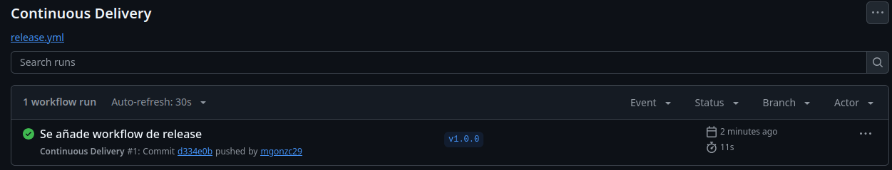

# Práctica 1: Integración y entrega continua con GitHub Actions

El presente trabajo tiene como objetivo aplicar mecanismos de integración y entrega continuas a un módulo Python sencillo, acompañado de su suite de pruebas, utilizando para ello GitHub Actions. El flujo automatizado valida cada cambio del código y genera un artefacto distribuible cuando se publica una nueva versión.

Asimismo, el repositorio se encuentra integrado con un webhook de Discord que notifica el resultado de los procesos en un canal de texto dedicado, lo que facilita el seguimiento del estado del pipeline sin necesidad de acceder a la interfaz de GitHub.

## Estructura del repositorio

```text
.
├── robot.py                  # lógica de movimiento del robot (can_move)
├── test_robot.py             # 4 pruebas unitarias con pytest
├── requirements.txt          # dependencias (pytest>=8,<10)
├── README.md
├── AI_USAGE.md
├── capturasLab/              # evidencias gráficas de la práctica
└── .github/workflows/
    ├── ci.yml                # pytest en cada push o pull request a main
    └── release.yml           # empaquetado al empujar un tag v*
```

## Capturas de la práctica

A continuación se recogen algunas evidencias gráficas interesantes sobre desarrollo de la práctica.

**1. Ejecución del workflow de integración continua (Continuous Integration)**


**2. Pasos del job de integración continua, entre los que destacamos la ejecución de `pytest`**


**3. Acceso a la opción para abrir el pull request desde la rama `feature/obstacle-detection`**


**4. Resultado de las pruebas en el pull request: dos fallos (`test_unsafe_distance` y `test_boundary_distance`) y dos superadas, con finalización del job con código de salida 1**


**5. Ejecución del workflow de entrega continua (Continuous Delivery) tras el envío del tag `v1.0.0`**



**6. Pasos del job de release automático, vemos de nuevo `pytest`, además del empaquetado y subida del artefacto**


## Preguntas de la práctica

1. **¿Qué ocurre exactamente en el valor límite de 0.5 metros?**

   ```python
   def can_move(distance: float) -> bool:
       """Return True if the robot can move safely."""
       if distance < 0:
           raise ValueError("Distance cannot be negative")
       return distance > 0.5
   ```

   Se devuelve `False`.

2. **¿Qué evento dispara el pipeline? ¿Qué ocurriría si se modifica el código sin ejecutar las pruebas localmente?**
