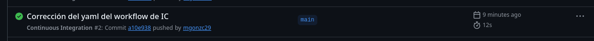
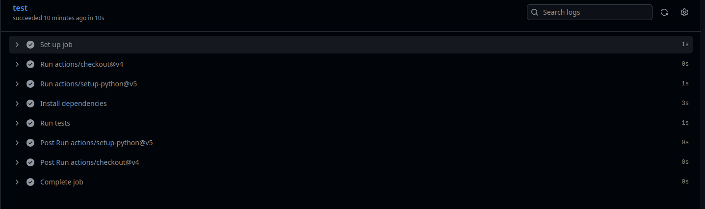
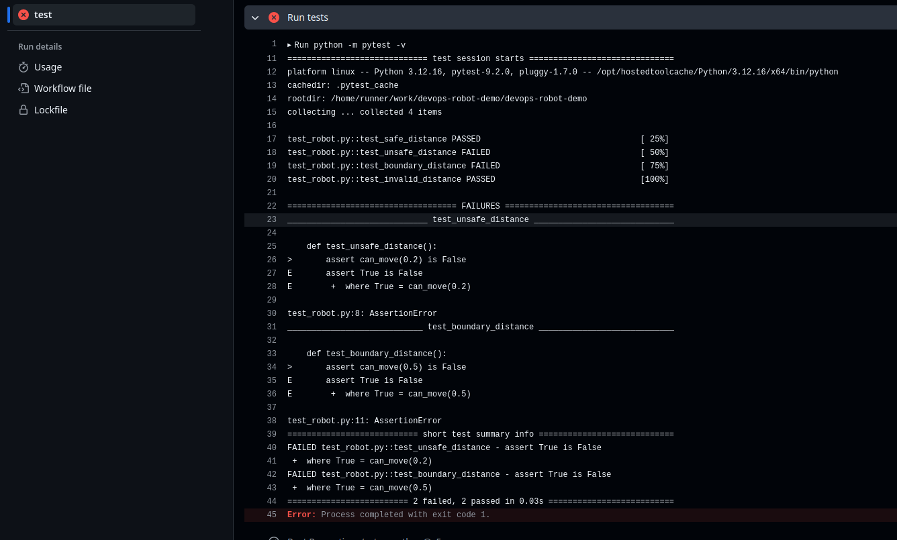
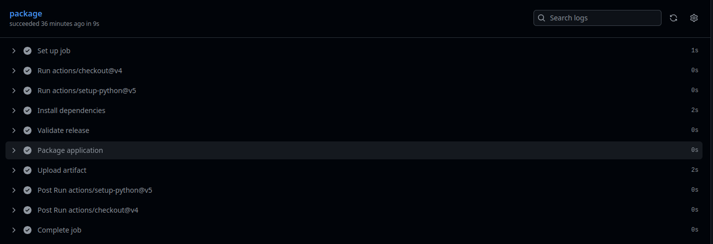

# Práctica 1: Integración y entrega continua con GitHub Actions

El presente trabajo tiene como objetivo aplicar mecanismos de integración y entrega continuas a un módulo Python sencillo, acompañado de su suite de pruebas, utilizando para ello GitHub Actions. El flujo automatizado valida cada cambio del código y genera un artefacto distribuible cuando se publica una nueva versión.

Asimismo, el repositorio se encuentra integrado con un webhook de Discord que notifica el resultado de los procesos en un canal de texto dedicado, lo que facilita el seguimiento del estado del pipeline sin necesidad de acceder a la interfaz de GitHub.

## Estructura del repositorio

```text
.
├── robot.py                  # lógica de movimiento del robot (can_move)
├── test_robot.py             # 4 pruebas unitarias con pytest
├── requirements.txt          # dependencias (pytest>=8,<10)
├── README.md
├── AI_USAGE.md
├── capturasLab/              # evidencias gráficas de la práctica
└── .github/workflows/
    ├── ci.yml                # pytest en cada push o pull request a main
    └── release.yml           # empaquetado al empujar un tag v*
```

## Capturas de la práctica

A continuación se recogen algunas evidencias gráficas interesantes sobre desarrollo de la práctica.

**1. Ejecución del workflow de integración continua (Continuous Integration)**



**2. Pasos del job de integración continua, entre los que destacamos la ejecución de `pytest`**



**3. Acceso a la opción para abrir el pull request desde la rama `feature/obstacle-detection`**


**4. Resultado de las pruebas en el pull request: dos fallos (`test_unsafe_distance` y `test_boundary_distance`) y dos superadas, con finalización del job con código de salida 1**



**5. Ejecución del workflow de entrega continua (Continuous Delivery) tras el envío del tag `v1.0.0`**


**6. Pasos del job de release automático, vemos de nuevo `pytest`, además del empaquetado y subida del artefacto**



## Preguntas de la práctica

1. **¿Qué ocurre exactamente en el valor límite de 0.5 metros?**

   ```python
   def can_move(distance: float) -> bool:
       """Return True if the robot can move safely."""
       if distance < 0:
           raise ValueError("Distance cannot be negative")
       return distance > 0.5
   ```

   Se devuelve `False`, porque la condición es estrictamente `distance > 0.5`.

2. **¿Qué evento dispara el pipeline? ¿Qué ocurriría si se modifica el código sin ejecutar las pruebas localmente?**

   El workflow de CI se dispara con un `push` o un `pull_request` hacia `main`, y el de entrega con el `push` de un tag que comienza con "v". Si se sube un cambio sin haber ejecutado las pruebas previamente en local, GitHub Actions se encargaría de realizarlas y en caso de fallo bloquea la integración hasta que se corrija..

3. **¿Qué aporta ejecutar las pruebas en GitHub Actions en vez de solo localmente?**

   Aporta automatización y reproducibilidad, ya que además de realizarse automáticamente evitando descuidos y olvidos, las pruebas se ejecutan siempre en el mismo entorno limpio.

4. **¿Qué sucede cuando un Pull Request contiene un fallo?**

   El job de CI termina con código de salida 1, apareciendo como fallido y se notifica el dicho resultado (también por el webhook de Discord). De esta manera la rama main queda protegida de código que no pase dichas pruebas.

5. **¿Para qué sirve proteger `main`?**

   Para impedir cambios directos y obligar a que todo llegue mediante un pull request revisado y con salidas exitosas en dichas revisiones, manteniendo estable y segura la rama principal.

6. **¿En qué se diferencian CI, Continuous Delivery y Continuous Deployment?**

   CI integra y valida automáticamente cada cambio; Continuous Delivery deja además el artefacto `robot-demo` preparado para poder desplegarlo, pero requiere una acción manual del desarrollador (el tag); Continuous Deployment despliega automáticamente en el entorno final tras pasar las pruebas.

7. **¿Es suficiente superar cuatro pruebas para desplegar software en un robot físico? Justifica tu respuesta.**

   No. Las cuatro pruebas unitarias cubren solo casos básicos de `can_move`; antes de desplegar en hardware harían falta diferentes pruebas de integración con sensores, en condiciones reales y manejo de errores entre otras, porque un fallo en el robot físico puede tener graves consecuencias.
